In [Part 2](/posts/Intel-vPro-Fleet-Services-Part-2-Deploying-the-Agent-with-Intune/), we packaged the agent, found out which devices can do vPro and watched the first endpoint show up in the portal. What we have not done yet is use any of it. This part changes that. We open the endpoint, go through the power actions, look at what the user on the other side of the screen gets to say about it, start a KVM session, reach the BIOS of a device from a browser, check what all of this leaves in the audit trail, and finally take an endpoint out of management again.

Everything here runs in Client Control Mode. As explained in [Part 2](/posts/Intel-vPro-Fleet-Services-Part-2-Deploying-the-Agent-with-Intune/#step-1-create-an-endpoint-group-and-download-the-agent), I do not have a provisioning certificate for Admin Control Mode in my lab yet, so user consent is part of everything you see below.

## The Series

| Part | Topic |
| --- | --- |
| [Part 1](/posts/Intel-vPro-Fleet-Services-Part-1-Onboarding-the-Tenant-and-Connecting-Entra-ID/) | Onboarding the tenant, passphrase handling, connecting Entra ID SSO and RBAC |
| [Part 2](/posts/Intel-vPro-Fleet-Services-Part-2-Deploying-the-Agent-with-Intune/) | Identifying vPro devices with a remediation, fixing the MEI driver, and onboarding clients by building and deploying the agent as an Intune app package |
| **Part 3** (this article) | Managing endpoints with vPro: power actions, KVM, remote recovery |

## Table of Contents

- [Thanks](#thanks)
- [Step 1: Open the Endpoint](#step-1-open-the-endpoint)
- [Step 2: Run a Power Action](#step-2-run-a-power-action)
  - [Power Off Is Not a Shutdown](#power-off-is-not-a-shutdown)
- [Step 3: Ask the User for Consent](#step-3-ask-the-user-for-consent)
- [Step 4: Start a KVM Session](#step-4-start-a-kvm-session)
  - [What the User Sees](#what-the-user-sees)
  - [RLE 8 or RLE 16](#rle-8-or-rle-16)
  - [Send Keys](#send-keys)
- [Step 5: Remote Recovery with BIOS and PXE](#step-5-remote-recovery-with-bios-and-pxe)
- [Step 6: Check the Audit Trail](#step-6-check-the-audit-trail)
  - [Endpoint Logs](#endpoint-logs)
- [Step 7: Stop Managing an Endpoint](#step-7-stop-managing-an-endpoint)
- [Things to Know Before You Hand This to Your Support Team](#things-to-know-before-you-hand-this-to-your-support-team)
- [Final Thoughts](#final-thoughts)
- [Wrap-Up](#wrap-up)

---

## Thanks

Lots of thanks to the Intel vPro Fleet Services team. 
In my lab, I worked with a test tenant they provided. 
So many questions, all patiently answered. 
All opinions and any mistakes here are my own.

---

## Step 1: Open the Endpoint

Go to Endpoints and select a device. The General tab shows the endpoint group, the current state and the Actions menu. The second tab, Hardware Remote Desktop, is the KVM session from Step 4.

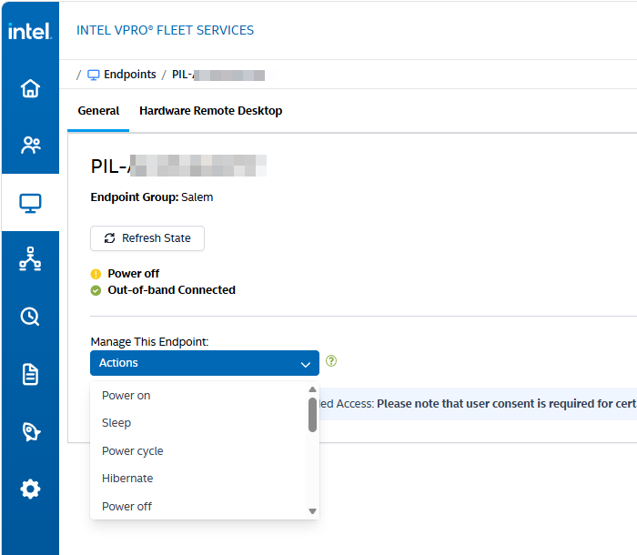

Look at the two status lines. My pilot device reports Power off and Out-of-band Connected at the same time. The device is off, and Fleet Services can still reach it. That is the difference between vPro and every tool that depends on a running Windows, including Intune itself.

Refresh State updates the green and yellow connection states. The blue banner below the Actions menu warns that user consent is required for certain actions, which brings us to Step 3.

---

## Step 2: Run a Power Action

The Actions menu is longer than it looks, and it scrolls. These are all the entries in my tenant, in the order of the menu.

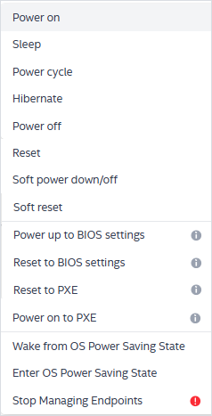

| Action | What it does | Needs a running OS |
| --- | --- | --- |
| Power on | Powers the device on | No |
| Sleep | Puts the device to sleep | Yes |
| Power cycle | Turns the power off and on again | No |
| Hibernate | Hibernates the device | Yes |
| Power off | Cuts the power, without asking Windows | No |
| Reset | Hard reset | No |
| Soft power down/off | Orderly shutdown through the OS | Yes |
| Soft reset | Orderly restart through the OS | Yes |
| Power up to BIOS settings | Powers on into the firmware setup | No, but the device must be on to show the consent code |
| Reset to BIOS settings | Resets into the firmware setup | No, but the device must be on to show the consent code |
| Reset to PXE | Resets into a network boot | No, but the device must be on to show the consent code |
| Power on to PXE | Powers on into a network boot | No, but the device must be on to show the consent code |
| Wake from OS Power Saving State | Brings Windows back from its power saving state to full power | Yes |
| Enter OS Power Saving State | Sends Windows into its power saving state | Yes |
| Stop Managing Endpoints | Removes the endpoint from Fleet Services, see Step 7 | No |

The names and the numbers come from Intel AMT, not from Fleet Services. The audit trail in Step 6 shows `ResetToBiosSettings` as action 101 and `ResetToPxe` as action 400, the same numbers as Reset to BIOS settings and Reset to PXE in the [AMT power states reference](https://device-management-toolkit.github.io/docs/2.39/Reference/powerstates/) of the Intel Device Management Toolkit.

### Power Off Is Not a Shutdown

This is the one to explain to your helpdesk. Power off and Reset do not ask Windows. They work on a hung device, and they also throw away whatever the user has not saved. If Windows is still alive, use Soft power down/off or Soft reset instead.

The soft actions need the OS side of AMT: Soft power down/off, Soft reset, Sleep and Hibernate are [local power actions that require LMS to be installed and running](https://device-management-toolkit.github.io/docs/2.39/Reference/powerstates/#local-power-actions) on the device. That is one more reason for the driver app from [Part 2](/posts/Intel-vPro-Fleet-Services-Part-2-Deploying-the-Agent-with-Intune/#step-5-fix-the-mei-driver-with-a-second-app), which installs LMS along with the MEI driver.

The last pair is easy to overlook. Wake from OS Power Saving State uses a [separate AMT call for bringing the platform back to full power](https://software.intel.com/sites/manageability/AMT_Implementation_and_Reference_Guide/WordDocuments/wakefrompowersavingstate.htm). It is the action to try when a device looks unreachable but has only gone into power saving.

---

## Step 3: Ask the User for Consent

Part 2 promised to show what the user gets to say about all of this. In Client Control Mode, the answer is simple: nothing that shows the screen or changes the boot target happens without them.

[Intel documents](https://software.intel.com/sites/manageability/AMT_Implementation_and_Reference_Guide/WordDocuments/userconsent1.htm) the consent policy as fixed in Client Control Mode. It covers KVM, storage redirection and setting boot options. Getting the power state or restarting the device [does not count](https://www.intel.com/content/www/us/en/developer/articles/technical/intel-vpro-setup-and-configuration-for-intel-active-management-technology.html). That is the answer to the question from [Part 1](/posts/Intel-vPro-Fleet-Services-Part-1-Onboarding-the-Tenant-and-Connecting-Entra-ID/#step-5-entra-id-role-based-access-control), and you can see it in the Actions menu, where the four BIOS and PXE entries carry an info icon.

| Needs consent | Does not need consent |
| --- | --- |
| Hardware Remote Desktop (KVM) | Power on, Power off, Power cycle, Reset |
| Power up to BIOS settings | Sleep, Hibernate |
| Reset to BIOS settings | Soft power down/off, Soft reset |
| Reset to PXE | Wake from and Enter OS Power Saving State |
| Power on to PXE | |

So an operator can power off a device without anyone agreeing to it, and needs the user for anything that shows the screen or changes what the device boots from. Keep that in mind for the role discussion at the end.

When an action needs consent, the portal asks for a code.

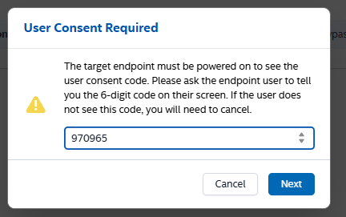

The dialog says it all: the target endpoint must be powered on to see the code, and the user reads the 6-digit code from their screen to you. If the user does not see the code, you have to cancel. Intel [draws the code with the Intel GPU](https://software.intel.com/sites/manageability/AMT_Implementation_and_Reference_Guide/WordDocuments/userconsent1.htm), and it is not available to the operating system. Software on the device cannot read it, so the code proves that someone looked at this screen.

This is what the user sees on the device:

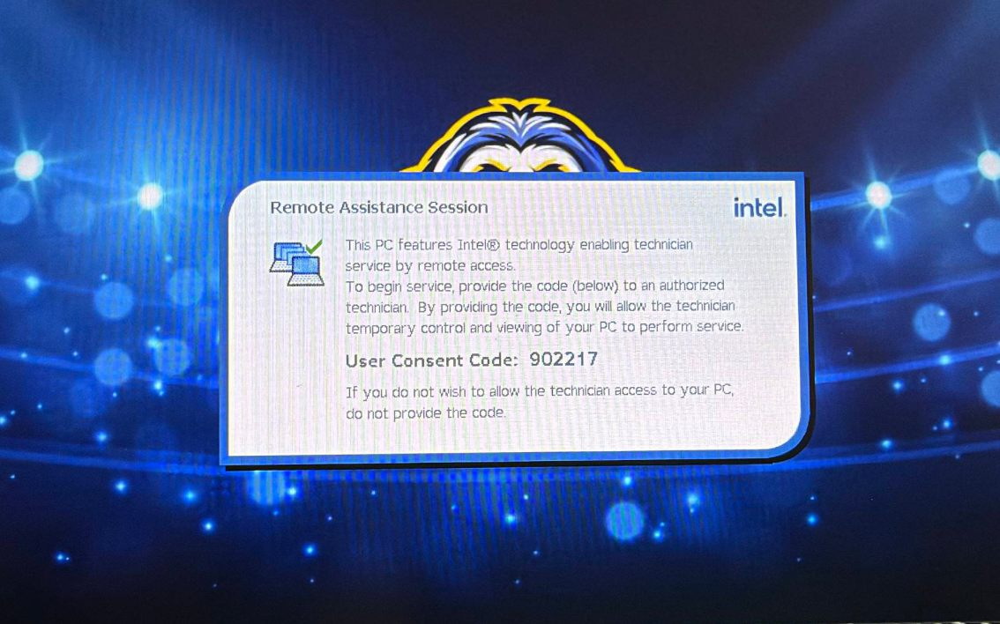

The Remote Assistance Session screen tells the user what the code means: by providing it, they allow the technician temporary control and viewing of their PC. If they do not want that, they simply do not provide the code.

A KVM session needs a 6-digit code as well, but the entry looks different. When you start the session, the Hardware Remote Desktop tab shows the Intel banner, a padlock and six empty positions. This is the admin side: the user reads the code from their screen, and you enter it here.

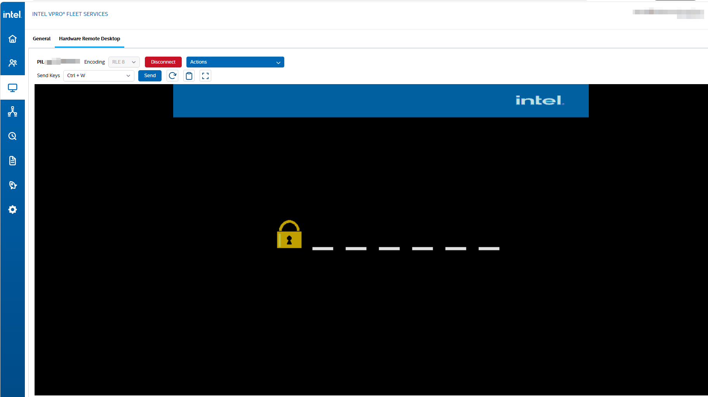

You do not need a new code for every action. The banner on the General tab explains the rule:

> For endpoints not activated with Unattended Access: **Please note that user consent is required for certain actions.** If consent was provided within the last 5 minutes, it will be reused, bypassing the need for additional approval. Additionally, an active KVM session will also bypass the need for further consent.

So one consent covers the next 5 minutes, and a running KVM session covers the actions you start while it is active. That helps with recovery: with KVM running, you can use the Actions menu in the session without asking the user for another code.

---

## Step 4: Start a KVM Session

Open the Hardware Remote Desktop tab, select the encoding, connect and enter the consent code from Step 3. The session runs in the browser, there is nothing to install on your side.

The toolbar gives you the essentials:

| Control | Purpose |
| --- | --- |
| Encoding | RLE 8 or RLE 16, see below |
| Disconnect | Ends the session |
| Actions | A shorter list of the actions from the General tab, without leaving the session |
| Send Keys | Sends key combinations to the device |
| Rotate screen | Rotates the screen |
| Paste | Pastes a string from your clipboard to the remote desktop |
| Full screen | Shows the session in full screen |
{: .nowrap-first}

The Paste button goes from your clipboard to the device, and its tooltip comes with a warning: the string is limited to 512 characters, and if it is too large, the screen may freeze temporarily.

The Actions menu in the session is not the full list from Step 2. It has six entries: Hibernate, Reset, Soft reset, Reset to BIOS settings, Reset to PXE and Stop Managing Endpoints. Power on, Sleep, Power cycle, Power off, Soft power down/off, the two power-on recovery entries and the OS power saving entries are not there.

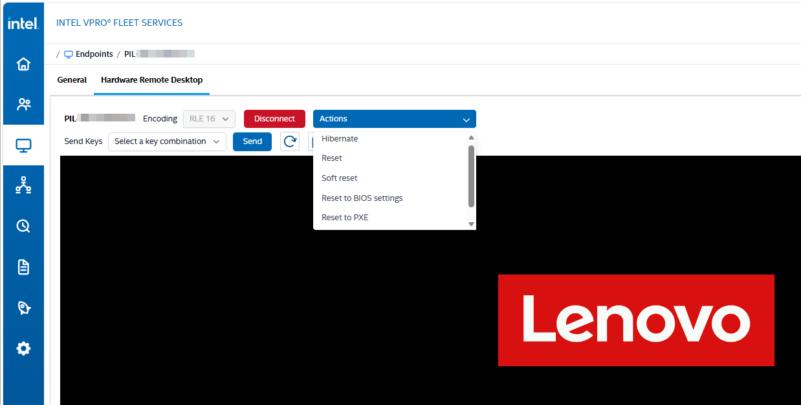

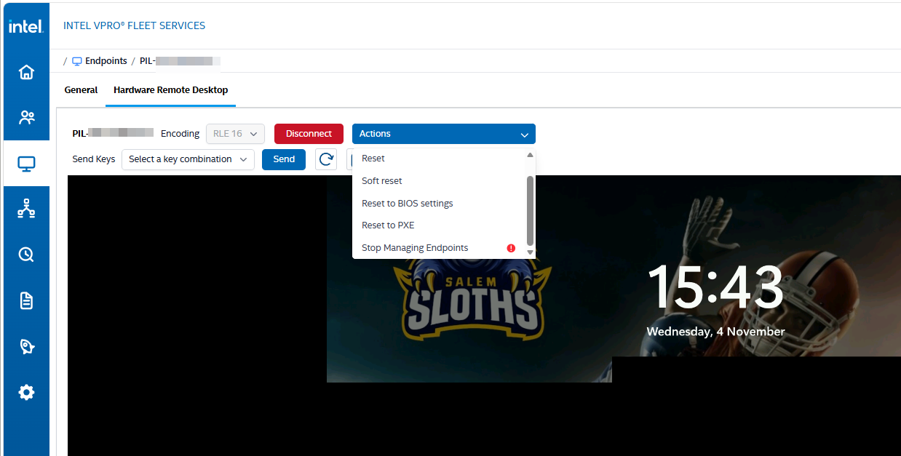

The BIOS and PXE entries have no info icon here. That fits the banner from Step 3, because an active KVM session bypasses further consent. The first screenshot also shows that the session stays connected during a restart, so you can watch the Lenovo logo from the browser.

### What the User Sees

A KVM session is not invisible. While it is active, the device shows a red and yellow border around the whole screen. These two photos are from the device itself, not from the portal. The first one shows the Windows lock screen:

The border stays during boot, when Windows is not running, so it does not depend on the operating system. On the Lenovo boot screen, a small icon also appears in the top right corner. It is just a connection overlay:

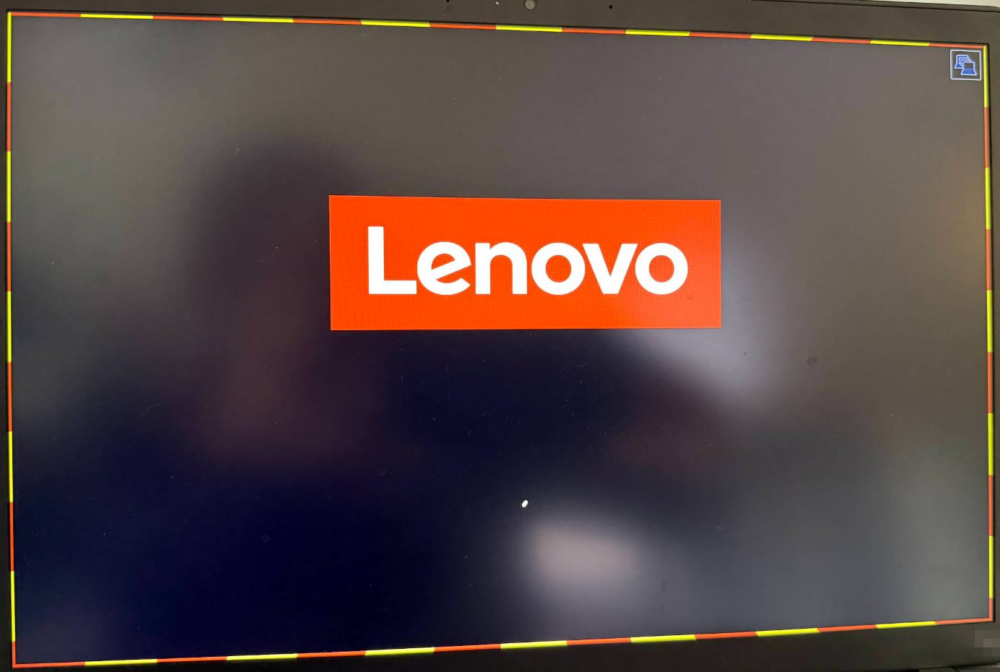

So anyone in front of the device can see that a session is running, from the firmware to the desktop. The user can keep working during the session, but they cannot end it.

### RLE 8 or RLE 16

The encoding is greyed out in all my screenshots of a running session, so choose it before you connect. The difference shows immediately. This is the same desktop with RLE 8 on top and RLE 16 below:

With RLE 8, the colors fall apart into bands, while RLE 16 looks like the real wallpaper. RLE 8 is not useless, though. Intel's [Manageability Commander guide](https://cdrdv2-public.intel.com/841492/Intel_MC_User_Guide.pdf) lists it as the encoding with the highest compression. In my test on a pilot device with 1920x1200 pixels, RLE 8 was faster, but both feel sluggish. My take: start with RLE 16 and switch to RLE 8 if the session is too slow or does not connect.

Do not expect the smoothness of a remote desktop tool. Screen changes arrive in pieces, and for a moment you see old and new content at the same time:

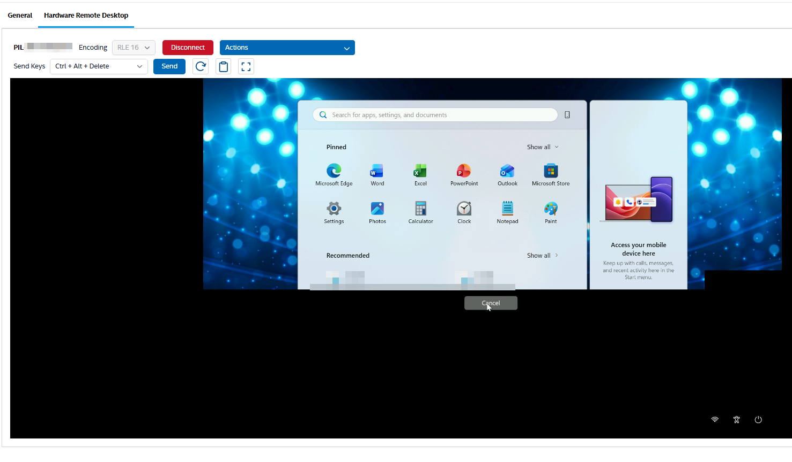

The Start menu in this screenshot is the old frame, the Cancel button and the icons at the bottom right already belong to the Ctrl+Alt+Delete screen. Wait a moment before you click. KVM is the tool for the moments when nothing else works, not a replacement for your regular remote support tool.

### Send Keys

Send Keys is there for the key combinations your own machine would keep for itself. Select the combination and press Send. Ctrl+Alt+Delete in the screenshot above reached the device, and that is the combination you need to get to the sign-in screen.

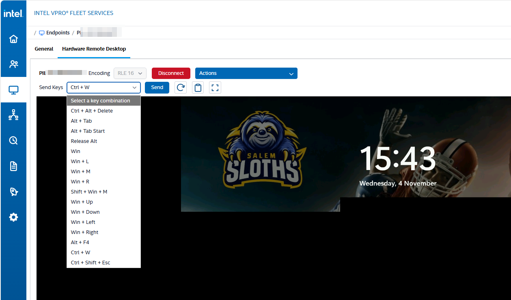

| Purpose | Combinations |
| --- | --- |
| Sign-in and lock | Ctrl + Alt + Delete, Win + L |
| Switching windows | Alt + Tab, Alt + Tab Start, Release Alt |
| Windows shortcuts | Win, Win + R, Win + M, Shift + Win + M |
| Moving windows | Win + Up, Win + Down, Win + Left, Win + Right |
| Closing | Alt + F4, Ctrl + W |
| Task Manager | Ctrl + Shift + Esc |

---

## Step 5: Remote Recovery with BIOS and PXE

This is the reason to do all of this. Reset to BIOS settings restarts the device into the firmware setup, and KVM shows it to you. No Windows, no agent, no Intune. My audit trail shows it as two events one minute apart: the reset at 14:25:49 and the KVM session at 14:26:50.

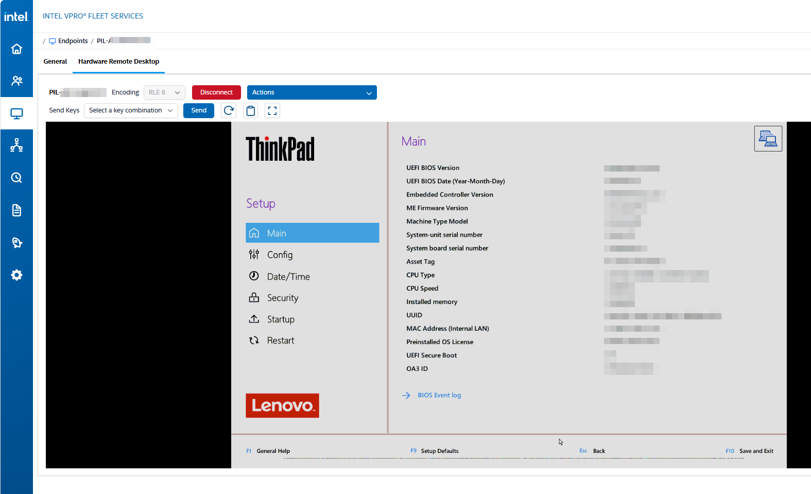

This is a Lenovo ThinkPad setup screen in a browser tab, on a device that is not running an operating system. You can check the firmware version, the boot order and the Secure Boot state, and change settings if the device needs it. The clean rendering is a nice side effect, because firmware screens have few colors.

The other recovery path is Reset to PXE or Power on to PXE. Combined with a network boot environment, that is how you get a broken device into a recovery or imaging environment without touching it. The audit trail shows my Reset to PXE at 14:29:11, and the consent dialog in Step 3 is from that action. In that first test, nothing happened, because my pilot device had no LAN cable connected. With a cable, Reset to PXE works, so this path needs a wired connection. There is no PXE server in my lab, so the device idled out at that point, and I could not test the full recovery path.

Power up to BIOS settings and Power on to PXE did not work in my test. You have to enter the code before the boot command is sent, and a device that is off cannot display the code. The workaround is to turn the device on first and then use Reset to BIOS settings or Reset to PXE. That also matches the [AMT power states reference](https://device-management-toolkit.github.io/docs/2.39/Reference/powerstates/): on a device that is already on, Power up to BIOS settings has no effect, and Reset to BIOS settings is the better choice. It does not need a running OS for this. As long as the device is on and the user can see the code, KVM is possible as well.

Be honest with yourself about the limit here. With user consent, recovery needs a person in front of the device who can read a code. For a user with a broken laptop on the phone, that works well. For a device in an empty office, it does not, and that is the case for Admin Control Mode from [Part 2](/posts/Intel-vPro-Fleet-Services-Part-2-Deploying-the-Agent-with-Intune/#step-1-create-an-endpoint-group-and-download-the-agent).

---

## Step 6: Check the Audit Trail

The actions from my test ended up in Logs > Audit trail. The second tab, [Endpoint logs](#endpoint-logs), holds the execution logs published by the endpoints.

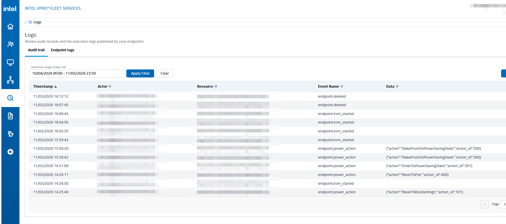

| Event Name | Data |
| --- | --- |
| `endpoint.power_action` | The action and its number, for example `{"action":"ResetToPxe","action_id":400}` |
| `endpoint.kvm_started` | Empty |
| `endpoint.deleted` | Empty |

From my test session, the actions look like this:

| Action | action_id |
| --- | --- |
| `ResetToBiosSettings` | 101 |
| `ResetToPxe` | 400 |
| `WakeFromOsPowerSavingState` | 500 |
| `EnterOsPowerSavingState` | 501 |

A few things are worth knowing:

- You get the actor, the resource, the time and the action. That answers who started what on which device.
- The log shows when a KVM session started. In my test, there was no matching event for the end of a session, and nothing about what happened in it. The audit trail tells you that an operator looked at a screen, not what they did there.
- The consent step does not show up as an event of its own.
- The date filter has a maximum range of 30 days. If you have to keep these records longer, use Export to CSV, which is available on both log tabs.
- The timestamps are in UTC, so they ran one hour behind the clock of my device. Keep that in mind when you compare them with Windows event logs.
- Only Tenant Administrators can read the audit log. Endpoint Operators do not have `audit_logs.read` ([Part 1](/posts/Intel-vPro-Fleet-Services-Part-1-Onboarding-the-Tenant-and-Connecting-Entra-ID/#the-roles)), so the people using KVM every day are not the ones who can see this record. For a control, that is the right way around.

### Endpoint Logs

The audit trail tells you who did what in the portal. The new Endpoint logs tab shows the other side: what ran on the device. Select the endpoint group and the endpoint, and you get a list with the timestamp, level, execution ID and message of each entry. All entries of a run share one execution ID, so you can use the filter to follow a single run.

Endpoint logs need agent 1.3.0 or newer, installed with the MSI property `STREAM_LOGS=YES`. Forwarding is off by default, and the package from [Part 2](/posts/Intel-vPro-Fleet-Services-Part-2-Deploying-the-Agent-with-Intune/#log-forwarding) turns it on.

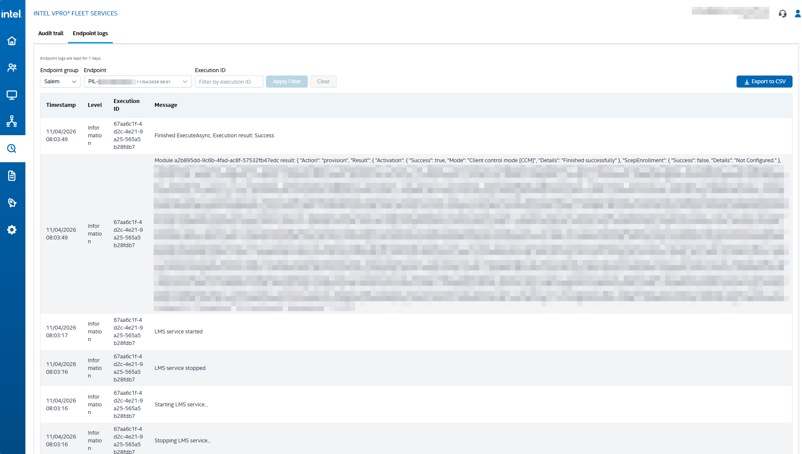

The newest entry is at the top, so read it from the bottom up. My screenshot shows a provisioning run. The LMS service is stopped and started, then a module reports its result, and the run ends with `Finished ExecuteAsync. Execution result: Success`.

The module result is the entry to read. For `"Action": "provision"`, it shows the activation with `"Success": true` and `"Mode": "Client control mode [CCM]"`, so you can confirm the activation and the control mode without touching the device. `ScepEnrollment` shows `"Success": false`, but the details say `Not Configured`, so there is nothing to fix.

Endpoint logs are kept for 7 days. If you need an entry for longer, for example for a support case, use Export to CSV.

An Endpoint Operator can read the Endpoint logs as well, but only for their assigned endpoint groups. The Audit trail tab is not there for them, so the Logs page only shows Endpoint logs:

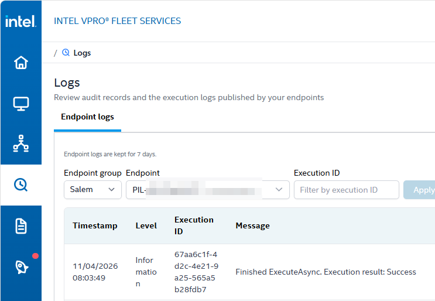

---

## Step 7: Stop Managing an Endpoint

The last entry in the Actions menu is the one with the red icon. As mentioned in [Part 2](/posts/Intel-vPro-Fleet-Services-Part-2-Deploying-the-Agent-with-Intune/#things-to-know-before-you-roll-out), this is how a device leaves Fleet Services. Uninstalling the agent does not do that.

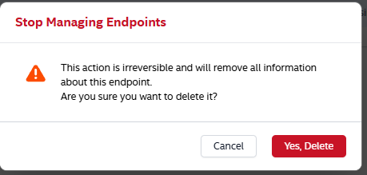

The portal asks once more and tells you the action is irreversible and removes all information about this endpoint. Select Yes, Delete, and then read the next dialog carefully.

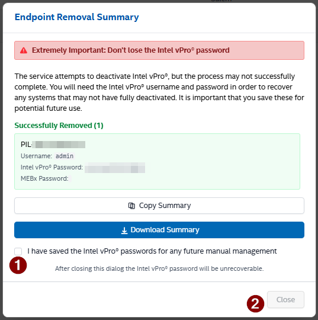

The Endpoint Removal Summary is the only place where you get the Intel vPro password, and the dialog is very clear about it: after closing, the password is unrecoverable. The service attempts to deactivate Intel vPro, but this may not complete. A device that stayed activated needs the username and password for the manual recovery.

Use Copy Summary or Download Summary, put the password in your password vault, select the checkbox (1), and only then does Close (2) become available. Do this even if the result says Successfully Removed, as it did in my test. Remember the [history from Part 1](/posts/Intel-vPro-Fleet-Services-Part-1-Onboarding-the-Tenant-and-Connecting-Entra-ID/#unprovisioned-is-not-the-same-as-off): a device with AMT configured and nobody holding the password is exactly the state we want to get away from.

After the removal, the device went back to `SoftwareActionNeeded` in the remediation from [Part 2](/posts/Intel-vPro-Fleet-Services-Part-2-Deploying-the-Agent-with-Intune/). To pair it again, I uninstalled and reinstalled the agent. If you skip Stop Managing Endpoints, you get a duplicate. I uninstalled the agent with the package, which un-pairs the device, and then installed the new version. The device showed up twice in the portal, which is why my audit trail has two `endpoint.deleted` events. Check the Endpoints list after a reinstall.

---

## Things to Know Before You Hand This to Your Support Team

- Consent protects the screen, not the power button. An Endpoint Operator can power off or reset any device in their endpoint groups, with the user in the middle of a meeting and no prompt. Your endpoint group scope from [Part 1](/posts/Intel-vPro-Fleet-Services-Part-1-Onboarding-the-Tenant-and-Connecting-Entra-ID/#the-roles) is the control for this.
- Operators can also stop managing endpoints. `endpoint.delete` is part of the Endpoint Operator role, so someone on the helpdesk sees the same removal dialog from Step 7 as a Tenant Administrator, with the only copy of that password on their screen. Agree on where it goes before that happens.
- Train the difference between Power off and Soft power down/off. The first one loses unsaved work.
- A KVM session is a view on a user's screen. If you are in the EU, the [GDPR points from Part 1](/posts/Intel-vPro-Fleet-Services-Part-1-Onboarding-the-Tenant-and-Connecting-Entra-ID/#before-you-start-eu-hosting-and-gdpr) apply here as well, and in Germany, the works council will want to talk about it. Consent helps with that discussion, but expect the question why the user cannot end a running session. If you move to Admin Control Mode later, it comes back.
- Export the audit trail if you need more than the 30 day view.

---

## Final Thoughts

Is this a replacement for your remote helpdesk tool? No. For daily support, your regular tool is faster and easier to work with. But vPro is another tool up your sleeve for the edge cases that tool cannot handle:

- A device does not start to the OS
- A device stops at the BitLocker recovery screen and you need to enter the recovery key
- You need access to the BIOS
- Your remote support solution has a problem and cannot reach the device
- You need to recover a device remotely, for example with [Cloud rebuild](https://support.microsoft.com/en-us/windows/experience/backup-recovery/cloud-rebuild) from Microsoft or the recovery solutions from the OEMs

All of this comes at no extra cost, because the hardware is already paid for, and the whole setup is really easy.

Because these are edge cases, I think access to this solution should be limited to 2nd or 3rd level support. These are the teams that end up with such cases anyway, and it keeps power actions, KVM and the removal dialog from Step 7 in the hands of fewer people. Your regular helpdesk keeps working with its usual tool and escalates when that tool reaches its limit.

---

## Wrap-Up

At this point you have:

- An endpoint you can reach while it is powered off
- Power actions, and a clear idea of which ones ask Windows first and which ones do not
- A consent flow your users understand, and an honest picture of what it allows and what it blocks
- KVM in the browser, from the Windows desktop down to the firmware setup
- An audit trail that shows who did what, and who can read it
- A clean way out of management, with the password in a safe place

That closes the series. In Part 1, I said there are only two acceptable states for vPro: claim it or disable it. After three parts, claiming it means a free service, one Win32 app, one remediation and a browser. The hardware was already in your fleet.

The piece that is still missing is Admin Control Mode. Without it, there is always a user in the loop, and that is fine for most helpdesk cases, but not for an empty office. Once I have a provisioning certificate in my lab, I may come back to unattended access in a follow-up.

---

_Intel, the Intel logo, Intel vPro and Intel Active Management Technology are trademarks of Intel Corporation or its subsidiaries. Other names and brands may be claimed as the property of others._
