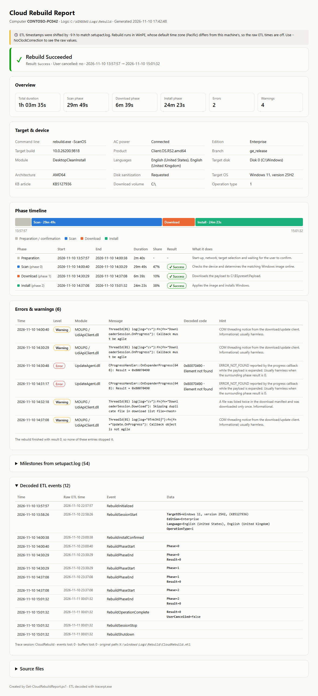
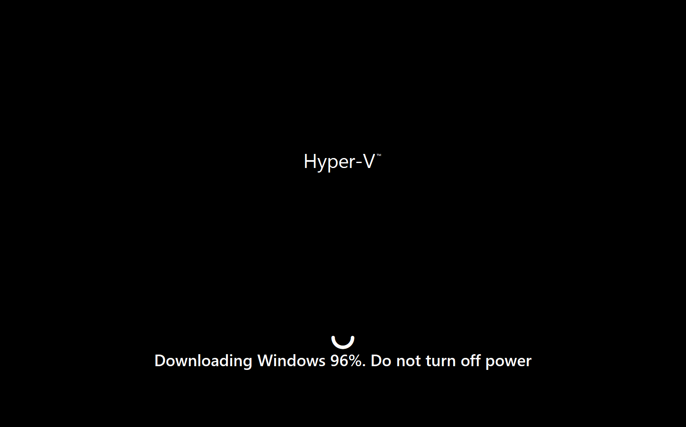
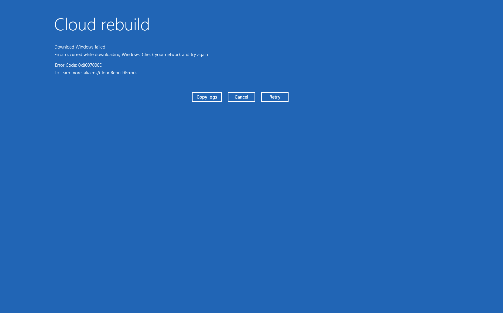
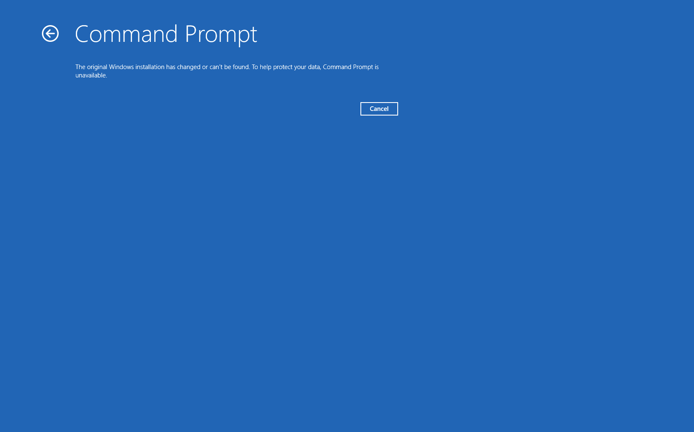
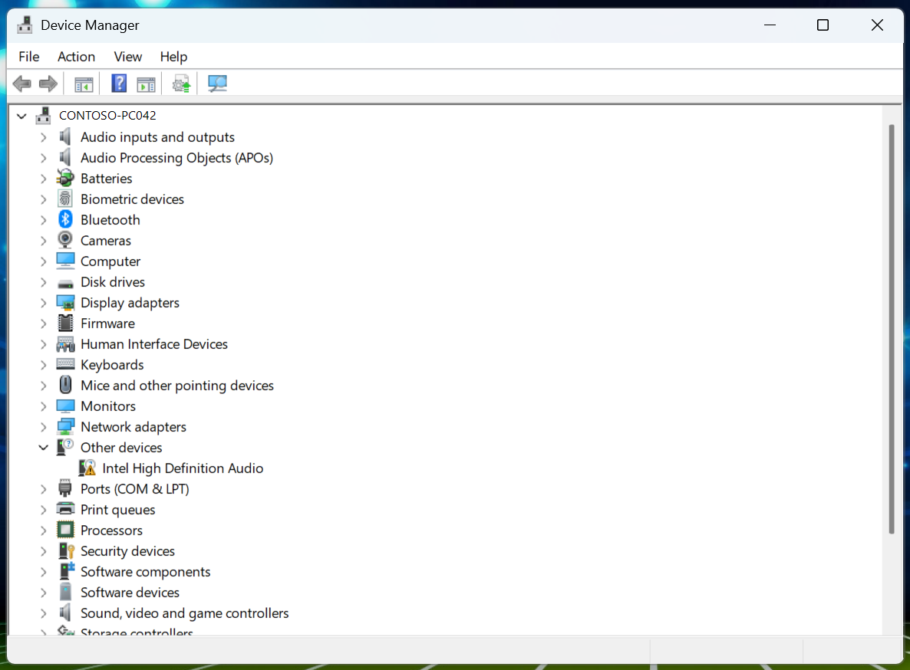

Cloud Rebuild reinstalls Windows on a device from a fresh image downloaded straight from Microsoft. You don't need a USB stick or a WDS server, but the device needs a working **Windows Recovery Environment (WinRE)**. The rebuild boots into WinRE, connects to the network from there and downloads the image. So WinRE has to be enabled (`reagentc /info`) and needs network drivers for the device's Ethernet or Wi-Fi adapter.

The device also needs a recent enough OS. Cloud Rebuild shipped with the October 2026 optional preview update [KB5127936](https://support.microsoft.com/help/5127936) and is included in the November 2026 security update [KB5132061](https://support.microsoft.com/help/5132061):

| Windows 11 version | Minimum build (KB5127936, optional) | November 2026 update (KB5132061) |
| --- | --- | --- |
| 25H2 | 10.0.26200.9818 | 10.0.26200.9974 |
| 26H2 | 10.0.26300.9818 | 10.0.26300.9974 |

Microsoft is rolling it out gradually, so a device on the right build may still not show **Rebuild PC** under Settings > System > Recovery right away.

I ran my first tests on a lab device this week and started the rebuild from the Settings app via **Rebuild PC**. The rebuild itself worked fine, but the logs it leaves behind are not exactly readable. So I wrote a small PowerShell script (with a lot of help from Claude) that turns them into a single HTML report.

This post covers where the logs are, what is in them, and what the report shows.

---

## Where the logs live

Rebuild runs inside **WinRE**, which is based on WinPE, so it starts logging on the RAM disk (`X:`) and moves the log session to the OS disk once the download volume is known. After the rebuild finishes, everything you need is here:

```text
C:\Windows\Logs\Rebuild
```

The only Rebuild-specific file is `CloudRebuild.etl`. The other four are the standard Windows Setup logs you already know from in-place upgrades and feature updates (Panther), so the usual setup troubleshooting know-how applies here too.

| File | Content |
| --- | --- |
| `CloudRebuild.etl` | TraceLogging events from the provider `Microsoft.Windows.CloudRebuild` - session start, phase start/end with result codes, final result, user cancelled flag |
| `setupact.log` | The detailed action log (40,000+ lines in my test) - edition, target build, network, disk sanitization, payload path, phase transitions |
| `setuperr.log` | Errors only |
| `diagerr.xml` / `diagwrn.xml` | Diagnostic errors and warnings, often several XML documents glued together in one file |
{: .nowrap-first}

While the rebuild is running, you can also find the logs in these places:

| Path | When |
| --- | --- |
| `X:\windows\Logs\Rebuild` | Preparation and scan phase (WinPE RAM disk) |
| `C:\$Sysreset\Logs` | From the download phase on, including `BT_Panther` setup logs |
| `C:\$Sysreset\Payload` | The downloaded Windows payload |
{: .nowrap-first}

### The time zone trap

WinPE runs in **Pacific Standard Time** by default. If the device's hardware clock holds local time (as it does on most Windows devices), the ETL timestamps are off by several hours. In my case it was 9 hours, and the file dates in the folder are shifted by the same amount. Keep this in mind before you match the rebuild against Intune or Entra sign-in events.

---

## The report script

`Get-CloudRebuildReport.ps1` uses only built-in tools:

- decodes `CloudRebuild.etl` with `tracerpt.exe`
- parses `setupact.log`, `setuperr.log`, `diagerr.xml` and `diagwrn.xml`
- detects the WinPE clock offset by comparing ETL and `setupact.log` timestamps and corrects it (`-NoClockCorrection` shows the raw values)
- decodes HRESULT / Win32 codes into readable text
- writes one self-contained HTML file

Run it on the rebuilt device:

```powershell
.\Get-CloudRebuildReport.ps1 -Open
```

Or point it at logs you collected from another device:

```powershell
.\Get-CloudRebuildReport.ps1 -LogPath D:\Collected\PC042\Rebuild -OutFile D:\Reports\PC042.html
```

By default the report is written to the desktop as `CloudRebuildReport_<computer>_<timestamp>.html`.

You can find the script in my GitHub repo: [Get-CloudRebuildReport.ps1](https://github.com/SasStu/Intune-Misc/blob/main/Scripts/Get-CloudRebuildReport.ps1)

---

## What my test looked like

Here is the (anonymized) report from my first run:



A few observations:

**Duration** - Just over an hour end to end. The **scan phase took almost half of it** (29m 49s), the download only 6m 39s and the install 24m 23s. Scan checks the device and determines the matching image online, so the download isn't what slows it down.

**Target** - Windows 11 25H2, build 10.0.26200.9818, Enterprise, with both installed languages (en-US and en-GB) taken over. The module is `DesktopCleanInstall`, so this is a real clean install, not a reset of the existing image.

**Disk sanitization** - I chose to sanitize the Windows disk in the confirmation dialog. The device only had one disk, so the disk selection page was skipped. The choice is injected into a generated `unattend.xml`.

**Errors and warnings** - Two errors (`0x80070490 - Element not found` from `UpdateAgent.dll` while the payload was expanded) and four warnings (COM threading notices and a duplicate file in the download list). The final result was `0`, so none of them stopped the rebuild. The report says this so you don't go chasing harmless entries.

**Decoded ETL events** - The expanded section at the bottom shows all 12 events from `CloudRebuild.etl`, with both the corrected and the raw ETL time. You can see the 9-hour WinPE offset side by side. The events trace the whole flow: initialized, session start with target OS, install confirmed, start and end of each phase with `Result=0`, and the final `RebuildOperationComplete` with `UserCancelled=false`. The other two collapsed sections hold the 54 milestones from `setupact.log` and the source file list.

---

## Watch out: keep the network connection stable

Make sure the device has a **stable network connection for the whole rebuild**. Don't start a rebuild on flaky Wi-Fi or a connection that might drop.

In one of my other tests, on a Hyper-V VM, the download failed, and the device was left with an **empty disk**.



The screen tells you not to turn off the power during the download, but a network interruption is just as bad. At 96% my download stopped with this error:



The screen offers **Copy logs**, **Cancel** and **Retry**. Use **Copy logs** before you do anything else. It only accepts removable media as the target, so keep a USB stick at hand. The device has no working Windows at this point, so those logs are the only record of what happened, and you can feed them to the report script later with `-LogPath`. Microsoft collects the known error codes at [aka.ms/CloudRebuildErrors](https://aka.ms/CloudRebuildErrors). The old Windows was gone, the new one wasn't installed, and nothing was left to boot from. On a physical device you would need another way to install an OS at that point: USB media, PXE/WDS or an OEM recovery option. That test device was a VM, so I could just go back to a snapshot.

Don't count on the other WinRE tools to get you out of this either. Command Prompt refuses to start because the original Windows installation can't be found anymore:



Cloud Rebuild is a great tool, but it isn't a safety net in itself. Have a plan B ready before you rely on it.

---

## One thing to watch: drivers

After the rebuild the device came up fine, but **Intel High Definition Audio** showed up without a driver:



That fits the clean install. You get the drivers that ship with Windows plus whatever Windows Update delivers, not the OEM driver pack that was on the device before. If you rely on Cloud Rebuild for recovery, make sure your driver update strategy (Windows Update for Business driver updates, Autopatch or OEM tools) covers this, or the user will notice it before you do.

---

## Wrap-up

Cloud Rebuild did what it promised on the first try. Troubleshooting it is a different story, because you have to piece the logs together yourself. With the script you get the result, phase durations, target build and any errors in one page. You can also send that page to a colleague without making them open a 5 MB `setupact.log`.

I will keep testing with more devices and models and update the script as I find new events or failure cases.

One more gap: the Intune **Collect diagnostics** action doesn't include `C:\Windows\Logs\Rebuild` yet. It does collect everything in `%ProgramData%\Microsoft\IntuneManagementExtension\Logs\*.*`. I'm currently testing a remediation that copies the Rebuild logs into that folder, so they show up in the diagnostics package until Microsoft adds them to the collection. More on that in a future post.
